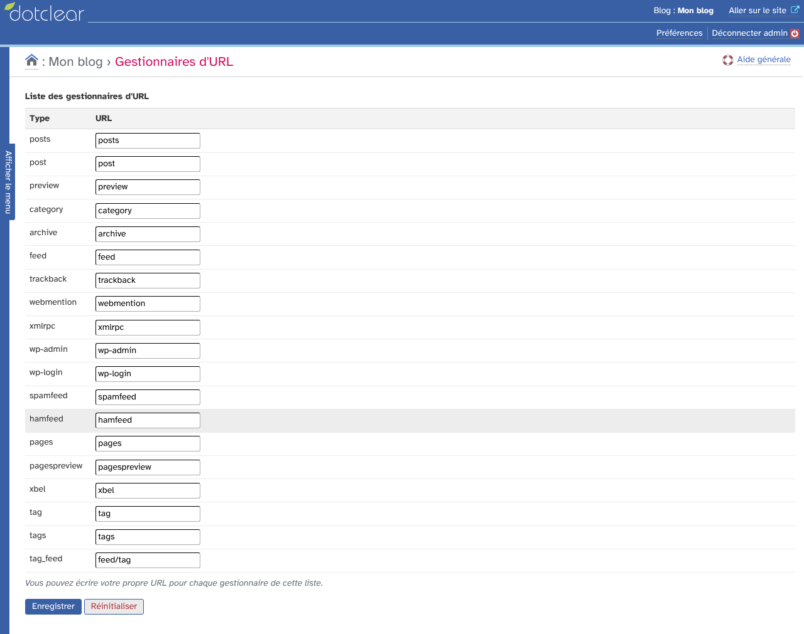
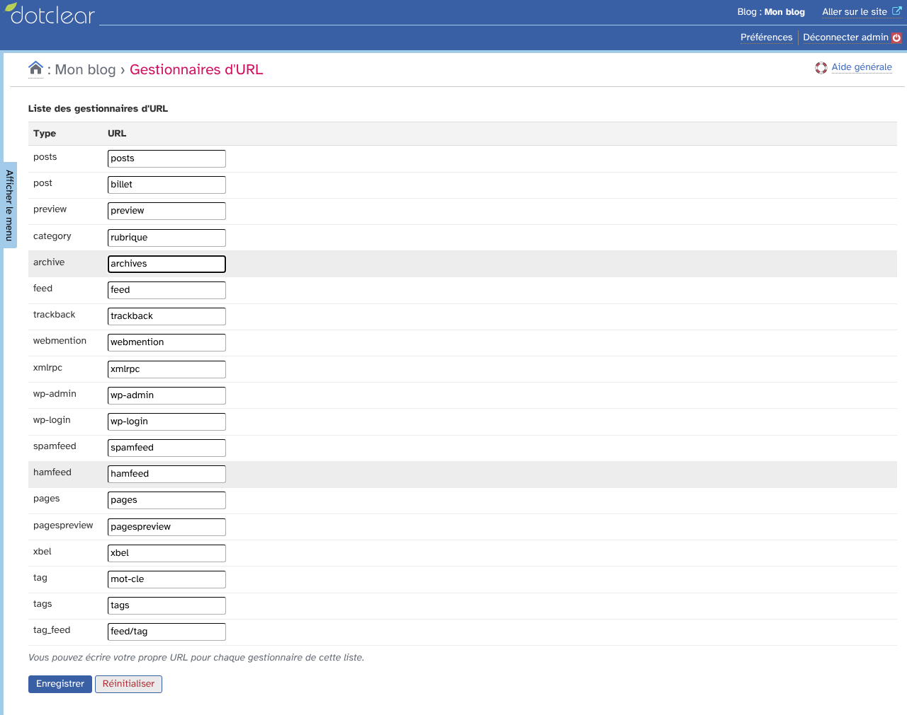
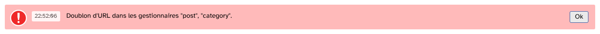

# myUrlHandlers : guide d'utilisation

Dotclear écrit les adresses de votre blog avec des mots fixes : `post` devant l'adresse d'un billet, `category` devant celle d'une catégorie, `tag` devant celle d'un mot-clé.
myUrlHandlers vous laisse remplacer ces mots par les vôtres.
Par exemple, `/post/mon-billet` devient `/billet/mon-billet`.

## Sommaire

* [Avant de commencer](#avant-de-commencer)
* [Changer un mot](#changer-un-mot)
* [Les types de la liste](#les-types-de-la-liste)
* [Ce qui change sur le blog](#ce-qui-change-sur-le-blog)
* [Les anciens liens](#les-anciens-liens)
* [Les règles à respecter](#les-règles-à-respecter)
* [Revenir aux adresses d'origine](#revenir-aux-adresses-dorigine)

## Avant de commencer

Ouvrez le menu « Plugins », puis « Gestionnaires d'URL ».
Le menu est réservé aux administrateurs.
Vous pouvez aussi ajouter l'icône de la page à votre tableau de bord, dans vos préférences, rubrique « Mes favoris ».

La page affiche un tableau à deux colonnes : le « Type » d'adresse, et l'« URL », c'est-à-dire le mot utilisé dans l'adresse.
Au départ, chaque champ contient le mot choisi par Dotclear.

## Changer un mot

Écrivez votre mot dans le champ de la ligne voulue.
Vous pouvez modifier plusieurs lignes à la fois.
Ici, les billets passent par `billet`, les catégories par `rubrique`, les mots-clés par `mot-cle` et les archives par `archives`.

Cliquez sur « Enregistrer ».
La page affiche « Les gestionnaires d'URL ont été mis à jour avec succès. ».

Avec ces réglages, les adresses du blog deviennent :

* un billet : `https://monblog.example/index.php/billet/bienvenue-sur-mon-blog` ;
* une catégorie : `https://monblog.example/index.php/rubrique/recettes` ;
* un mot-clé : `https://monblog.example/index.php/mot-cle/soupe` ;
* les archives : `https://monblog.example/index.php/archives`.

La forme exacte du début de l'adresse (avec ou sans `index.php`) dépend du réglage des adresses de votre blog.

## Les types de la liste

| Type | Ce que l'adresse affiche | Exemple |
|---|---|---|
| `posts` | la liste des billets | `posts` |
| `post` | un billet | `post/bienvenue-sur-mon-blog` |
| `category` | une catégorie | `category/recettes` |
| `archive` | les archives | `archive` |
| `feed` | les flux du blog | `feed/atom` |
| `tags` | la liste des mots-clés | `tags` |
| `tag` | un mot-clé | `tag/soupe` |
| `tag_feed` | le flux d'un mot-clé | `feed/tag/soupe/atom` |
| `pages` | une page du plugin Pages | `pages/a-propos` |

Les autres lignes (`preview`, `pagespreview`, `trackback`, `webmention`, `xmlrpc`, `wp-admin`, `wp-login`, `spamfeed`, `hamfeed`, `xbel`) sont des adresses techniques : aperçus, rétroliens, mentions web, publication à distance, flux de l'antispam, liste de liens.
Laissez-les telles quelles, sauf besoin précis.

Les types des plugins installés (comme `pages`) apparaissent aussi dans la liste.

## Ce qui change sur le blog

Le blog écrit ses liens avec vos mots : les liens d'un billet vers sa catégorie ou vers les archives, l'adresse des flux dans l'en-tête des pages, les liens des pages.
Vous n'avez rien d'autre à modifier.

Chaque blog a ses propres adresses.

## Les anciens liens

Quand vous changez un mot, l'ancienne adresse ne fonctionne plus : elle renvoie une erreur 404.
Les liens que d'autres sites ont fait vers vos billets, les marque-pages de vos lecteurs et les liens écrits à la main dans vos billets ou dans votre menu cessent de marcher.

Changez donc ces mots tôt, avant que le blog soit très connu, et corrigez les liens écrits à la main.

## Les règles à respecter

* Chaque type a son propre mot : deux types ne peuvent pas avoir le même. La page affiche alors « Doublon d'URL dans les gestionnaires "post", "category". » (avec les types concernés) et rien n'est enregistré.
* Un champ ne peut pas être vide. La page affiche « URL invalide pour le gestionnaire "post". » (avec le type concerné) et rien n'est enregistré.
* Le plugin nettoie ce que vous écrivez : les espaces deviennent des tirets. Il garde les accents et la ponctuation, qui donnent des adresses peu pratiques : écrivez plutôt des lettres minuscules sans accent, des chiffres et des tirets.

## Revenir aux adresses d'origine

Cliquez sur « Réinitialiser ».
La page affiche « Les gestionnaires d'URL ont été restaurés avec succès. » et tous les champs retrouvent les mots d'origine.
Il n'y a pas de demande de confirmation.
